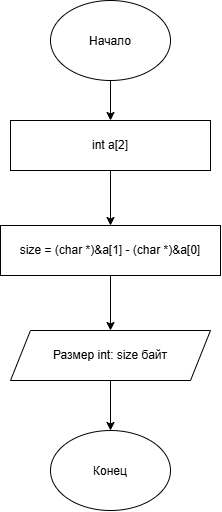

# Домашнее задание к работе номер 12

## Условие задачи

Напишите программу, которая вычисляет размер типа данных int в байтах.

## 1. Алгоритм и блок-схема

### Алгоритм

1. Начало.

2. Объявить массив типа int и размера 2.

3. Преобразовать адреса элементов в тип данных char * и вычесть из второго указателя первый.

4. Конец.

### Блок-схема



## 2. Реализация программы

```c
#define _CRT_SECURE_NO_WARNINGS
#include <stdio.h>
#include <locale.h>

int main(void)
{
    setlocale(LC_CTYPE, "RUS");
    int a[2];
    long size = (char *)&a[1] - (char *)&a[0];
    printf("Размер int: %ld байт\n", size);
    return 0;
}
```

## 3. Результаты работы программы

Пример:\
 \
Размер int: 4 байт

## 4. Информация о разработчике

Литуновский Максим Дмитриевич, бТИИ-261
